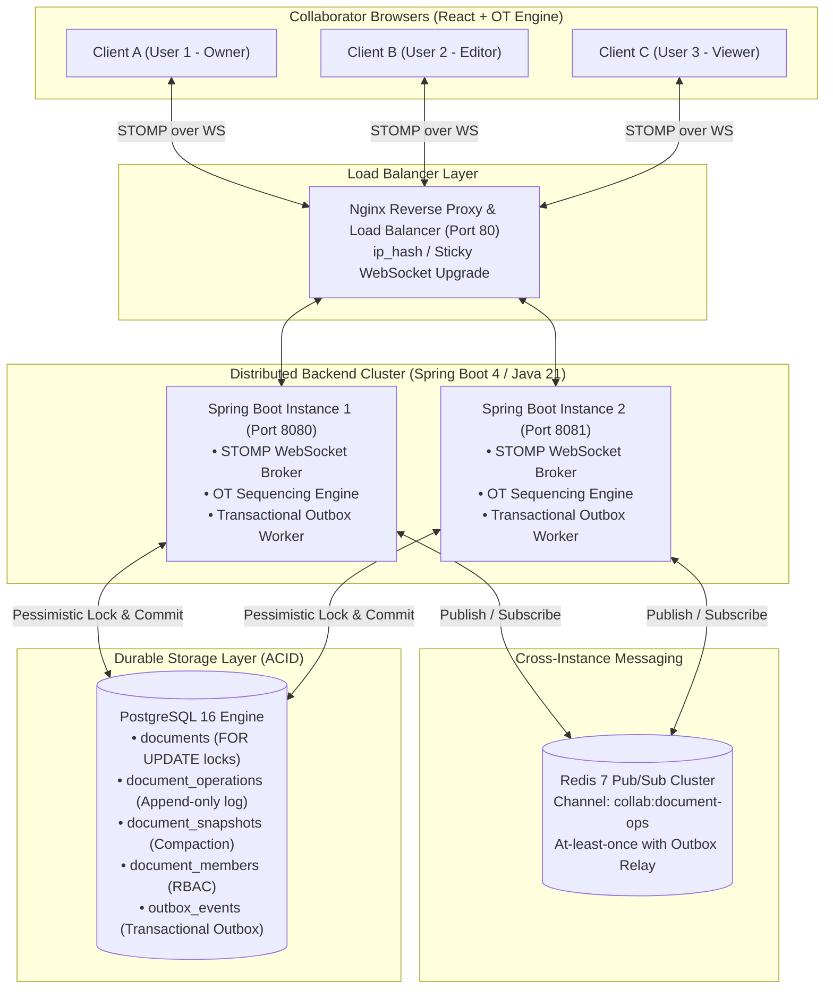
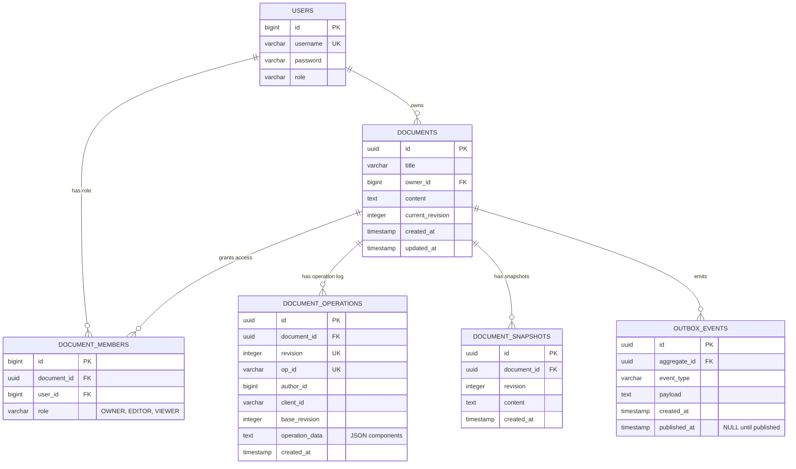

# System Design Portfolio: Real-Time Collaborative Document Editor

## 1. Executive Summary & Problem Definition

The **Real-Time Collaborative Document Editor** is a distributed, high-concurrency text editing system where multiple concurrent users can co-edit the same document simultaneously without locks and without data loss.

### The Core Distributed Concurrency Problem
When multiple distributed clients edit the same document concurrently starting from the same base revision $R$, their edits arrive at the backend in non-deterministic order. If edits were blindly applied, character positions would drift, leading to text corruption and diverging states across clients.

### Architectural Solution
The system employs **Server-Authoritative Operational Transformation (OT)** combined with **PostgreSQL Row-Level Locking (`PESSIMISTIC_WRITE`)**, **Append-Only Operation Logs**, **Periodic Snapshotting**, **Transactional Outbox Relaying**, and **Redis Pub/Sub** for multi-node horizontal scaling.

---

## 2. High-Level Architecture Diagram



---

## 3. Database Schema & Entity-Relationship Diagram



---

## 4. End-to-End Sequence Flows

### A. Concurrent Edits & Server-Authoritative OT Sequencing

```mermaid
sequenceDiagram
    autonumber
    actor A as Client A (Base Rev 42)
    actor B as Client B (Base Rev 42)
    participant N1 as Backend Instance 1
    participant DB as PostgreSQL
    participant R as Redis Pub/Sub
    participant N2 as Backend Instance 2

    A->>N1: STOMP Edit OpA (baseRev: 42, opId: "uuid-A")
    B->>N2: STOMP Edit OpB (baseRev: 42, opId: "uuid-B")
    
    rect rgb(20, 30, 45)
    Note over N1,DB: Instance 1 acquires row-level lock first
    N1->>DB: SELECT * FROM documents WHERE id = :id FOR UPDATE
    N1->>DB: Check idempotency (exists by opId)
    N1->>N1: baseRev(42) == currentRev(42) -> No transformation needed
    N1->>DB: INSERT document_operations (rev: 43, opA)
    N1->>DB: UPDATE documents (content = apply(opA), rev: 43)
    N1->>DB: INSERT outbox_events (OPERATION_COMMITTED)
    N1->>DB: COMMIT Transaction
    end

    N1->>R: Publish OpA (rev: 43) to collab:document-ops
    N1-->>A: STOMP ACK (opId: "uuid-A", rev: 43)

    rect rgb(35, 20, 40)
    Note over N2,DB: Instance 2 acquires lock next
    N2->>DB: SELECT * FROM documents WHERE id = :id FOR UPDATE
    N2->>DB: Read currentRev -> 43 (OpB baseRev was 42 -> Stale detected!)
    N2->>DB: SELECT operations WHERE doc_id = :id AND rev > 42 -> Fetches OpA
    N2->>N2: OpB' = OTEngine.transform(OpB, OpA, priority=false)
    N2->>DB: INSERT document_operations (rev: 44, OpB')
    N2->>DB: UPDATE documents (content = apply(OpB'), rev: 44)
    N2->>DB: INSERT outbox_events (OPERATION_COMMITTED)
    N2->>DB: COMMIT Transaction
    end

    N2->>R: Publish OpB' (rev: 44) to collab:document-ops
    N2-->>B: STOMP ACK (opId: "uuid-B", rev: 44)

    R-->>N1: Receive OpB' (rev: 44)
    N1-->>A: Broadcast OpB' -> Client A applies to local doc
    R-->>N2: Receive OpA (rev: 43)
    N2-->>B: Broadcast OpA -> Client B transforms pending and applies
    Note over A,B: Client A and Client B arrive at 100% identical content!
```


---

## 5. Answers to the 17 System Design Review Questions (Section 7)

### 1. Why are WebSockets suitable for this workload compared with REST polling?
REST polling requires opening a new TCP + TLS handshake and sending HTTP headers for every poll interval (e.g. 500ms). This creates extreme bandwidth waste, server CPU overhead, and inherent latency jitter (up to 500ms). WebSockets establish a single persistent, full-duplex TCP connection with a tiny 2-byte framing overhead, delivering sub-20ms push updates instantly upon commitment.

### 2. Why is the application distributed when there are two Spring Boot instances?
A single node cannot scale indefinitely and represents a Single Point of Failure (SPOF). Having two Spring Boot instances distributes WebSocket connection capacity and CPU processing. It is truly distributed because:
- Clients connect to different physical servers with independent heap memory and event loops.
- Local memory cannot be shared; coordination requires a distributed broker (Redis) and durable ACID coordinator (PostgreSQL).
- Node crashes do not bring down the entire cluster.

### 3. How do you prevent concurrent operations from overwriting one another?
By combining **PostgreSQL Pessimistic Row Locking (`SELECT ... FOR UPDATE`)** with **Server-Authoritative Revision Numbering**. When an edit arrives, the document row is locked for the duration of the short transaction. The server checks the document's `currentRevision`. If the incoming operation was generated on an older `baseRevision`, it is transformed against all intervening accepted operations from the immutable operation log before being applied. Writes are strictly serialized per document.

### 4. How is synchronization different from conflict resolution?
- **Synchronization** is the transport and ordering mechanism that ensures all participants receive all updates (e.g. STOMP over WebSocket, sequence numbers, catch-up APIs).
- **Conflict Resolution** is the algorithmic reconciliation of conflicting, concurrent operations that were created on the same base state (e.g. Operational Transformation math or CRDT convergence rules).

### 5. What happens if Redis loses a message?
Redis Pub/Sub is fundamentally at-most-once and does not buffer messages. If a message is lost in transit:
1. **Revision Gap Detection**: When a client receives revision $R+2$ while at revision $R$, it detects a gap.
2. **PostgreSQL Catch-Up**: The client queries `GET /api/documents/{id}/sync?sinceRevision=R` (or WebSocket `/app/sync/{documentId}`). The server retrieves the durable operations from `document_operations` in PostgreSQL and returns them to the client.
3. **Transactional Outbox Pattern**: In the event of temporary Redis disconnection, the `OutboxRelayService` polls `outbox_events` and replays pending messages.

### 6. What if the server crashes immediately after saving an operation?
The operation was already committed to PostgreSQL in an atomic ACID transaction. The database state, new revision, and `outbox_events` record are fully durable on disk. When the transaction finishes, the outbox record ensures that the notification is published once the cluster or outbox worker recovers. Reconnecting clients will fetch the committed revision via the sync endpoint. No data is lost.

### 7. How does a stale client revision get transformed or resynchronized?
When an edit arrives with `baseRevision < currentRevision`, the server queries:
```sql
SELECT * FROM document_operations WHERE document_id = :docId AND revision > :baseRevision ORDER BY revision ASC;
```
The server passes the incoming operation through `OTEngine.transform(incomingOp, interveningOp, false)` for each accepted operation. This rebases the edit to the document's tip revision without requiring the client to resubmit.

### 8. How do you make duplicate delivery harmless?
Through **Idempotency Keys (`opId`)**:
Each operation contains a unique client-generated UUID `opId`. The database enforces a `UNIQUE(document_id, op_id)` constraint. Before applying an edit, the server checks if `opId` exists. If so, it immediately returns the existing committed revision and operation without re-applying the edit.

### 9. Why can a Java synchronized block not coordinate different backend instances?
Java's `synchronized` keyword, `ReentrantLock`, and local JVM monitors only protect threads within a single JVM process on one machine. They have no visibility into other JVM processes running on different containers or hosts. Distributed systems require database locks, distributed locks (Redlock / Redis SETNX), or messaging brokers.

### 10. What changes when 10,000 users connect?
- **Connection limits**: 10,000 long-lived WebSocket TCP sockets exceed single-process file descriptor limits. We scale out to 10+ Spring Boot nodes behind a load balancer cluster.
- **Database contention**: 10,000 concurrent writes to PostgreSQL would cause row-lock bottlenecks. We introduce document partitioning, where each active document has a single dedicated in-memory writer / actor (e.g. Akka / virtual actors), batching commits to PostgreSQL every 50ms.
- **Epoll / Netty**: Replace Tomcat blocking I/O with Netty reactive WebSocket gateways.

### 11. What is the current single point of failure?
In the initial setup, a single PostgreSQL instance and single Redis instance represent SPOFs. In production, we deploy PostgreSQL with streaming replication + Patroni automated failover, and Redis Sentinel / Redis Cluster with multi-replica failover.

### 12. What becomes the bottleneck for a very popular document?
The row-level lock on the single document row in PostgreSQL (`SELECT ... FOR UPDATE`). All edits for that document must wait in queue.
**Solution**:
1. Single-writer in-memory actor per active document holding state in RAM.
2. Group commit: batching 20-50 operations into a single combined PostgreSQL transaction every 10-20ms.

### 13. Would you partition by user or document, and why?
**Partition by document**. All operations on the same document must be sequenced in a single authoritative linear timeline. Partitioning by document ensures that all edits for Document X route to the same sequencer node or database shard, eliminating cross-partition distributed transactions (2PC).

### 14. When would Kafka or Redis Streams be preferable to Redis Pub/Sub?
Redis Pub/Sub has zero retention and at-most-once delivery. **Kafka or Redis Streams** are preferable when:
- Durable event sourcing is needed without hitting the database for replay.
- Consumer groups need to replay events from arbitrary offsets after downtime.
- Multi-region replication and guaranteed log compaction are required.

### 15. When would you choose CRDT instead of OT?
- **Choose CRDT (e.g. Yjs, Automerge)**: For peer-to-peer (P2P), local-first, or offline-first editing where clients must edit without a central server authority for days, then merge automatically without server coordination.
- **Choose OT**: For central server-authoritative architectures (Google Docs) where server enforces strict access control, business permissions, linear revisions, and low client memory overhead.

### 16. How would offline-first editing change the design?
The client would store the document and operation log in IndexedDB. Edits made offline would accumulate causal dependencies (vector clocks). Upon reconnection, the client would either execute multi-revision OT rebasing against the server tip or use CRDT state vectors to reconcile conflicts.

### 17. What new problems arise in a multi-region architecture?
- **Speed-of-light cross-region latency**: A synchronous row-lock across regions (e.g. US to EU) adds 100ms+ round-trip latency to every single keystroke.
- **Network partitions (Split-Brain)**: CAP theorem forces choosing between Availability and Consistency.
- **Solution**: Designate a single home region per document (single-leader), or switch to multi-region CRDTs with asynchronous eventual consistency.

---

## 6. Architecture Decision Records (ADRs)

### ADR-1: Server-Authoritative Operational Transformation (OT) over CRDT
- **Status**: Accepted
- **Context**: Need real-time multi-user editing with exact convergence and manageable metadata.
- **Decision**: Implement server-authoritative OT.
- **Rationale**: Server maintains a single immutable sequence of revisions. Simpler metadata footprint compared to CRDT tombstone bloat. Enables immediate RBAC enforcement on every operation.

### ADR-2: PostgreSQL Row-Level Locking (`PESSIMISTIC_WRITE`) for Per-Document Serialization
- **Status**: Accepted
- **Context**: Concurrent operations on the same document must not interleave unpredictably.
- **Decision**: Use `SELECT ... FOR UPDATE` row locks inside short transactions.
- **Rationale**: Guarantees ACID serialization, prevents lost updates, and ensures that `currentRevision` increments strictly monotonically.

### ADR-3: Redis Pub/Sub Combined with Transactional Outbox Pattern
- **Status**: Accepted
- **Context**: Edits committed on Instance A must be broadcast to clients connected to Instance B.
- **Decision**: Publish notifications via Redis Pub/Sub, backed by a persistent `outbox_events` table in PostgreSQL.
- **Rationale**: Sub-millisecond fan-out latency with zero message loss guarantee even if Redis restarts.

### ADR-4: JWT Token Channel Interceptor for STOMP WebSocket RBAC
- **Status**: Accepted
- **Context**: Need to enforce Owner, Editor, and Viewer permissions on both HTTP and WebSocket frames.
- **Decision**: Intercept STOMP `CONNECT` and `SUBSCRIBE` / `SEND` frames via Spring `ChannelInterceptor`, extracting and validating signed JWT claims.
- **Rationale**: Identity is derived strictly from cryptographic security context, preventing client impersonation.

